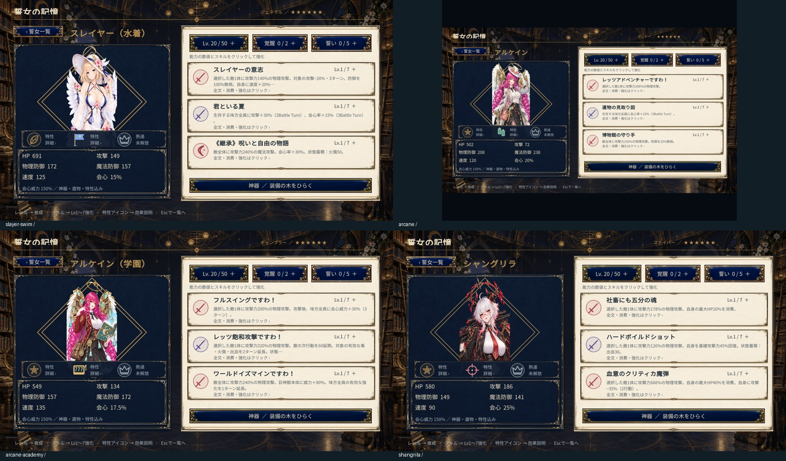

# newASTER

Windows・オフライン向け、Unityの2DイラストRPG。万物の書から巨神獣を召喚し、詩と素材を集めて世界を復元し、天使ヒロインの物語と交流を進める。

現行は **24形態・21人・全13ジョブ、15巨神獣・7世界、117章792詩・120交流**。アイオーン、アイアンメイデン、アヴァランチ、アナテマ、シヴァ、インヴィジブル、ヴァイパー、ヴィンディーケーター、ウェポンマスターまで追加済み。加入・戦闘・育成・神器・編成・庭・ADVを接続し、性格・口調・概要を人物資料へ保存している。

万物の書のしおりで各画面を移動し、操作説明は右上の「？」から開く。立ち絵は元画像の比率を維持する。神器は全ヒロイン共通の自然木と丸いノード枠で表示し、開放に連動する薄い葉・ノード周囲の花を本人のイメージカラーで重ねる。吊り下げ装飾は使用しない。オーパーツ42種類は巨神獣討伐・レリックハントで入手できる。

Plan11-2では、9庭の自律生活、二人の交流、10種類の催事、30件の生活発見、10件の記念家具、即時作成と模様替え、生活記録と鑑賞を追加した。



Plan11-3では、人物ごとの好感度Lv／EXP、Lv10の恋人自動成立、繰り返し交流・戦闘EXP、Lvだけで解放する可変回想と、永遠の誓環による上限20→99を追加した。

Plan11-4では、編成枠のオーパーツ装備、5能力のLv成長と累積抽選、独立した最大2効果、パンツァーのバフ延長、編成プリセット、原子的強化と旧セーブ移行を追加した。所持だけの全体補正は廃止した。編成は独立したしおりへ移動し、誓女の画像と直下のオーパーツ枠から入れ替える。入れ替えは左に詳細・右に候補を並べ、「決定」で反映する。

## 起動・ビルド

ローカルの最新実行ファイルは `game/Builds/plan12-weapon-master/newASTER.exe`。実行ファイルと元動画はGitへ同梱しない。

Unity **6000.6.3f1**で `game/unity` を開き、`Assets/Game/Scenes/Bootstrap.unity` を再生する。WindowsビルドはEditorの `Plan12WeaponMasterBuild.ValidateAndBuild` を実行する。通常入口は `ProductionContentPaths` に定義した `Combat/battle-plan12-weapon-master` と `Story/plan12-weapon-master-story-content`。[5人の完了記録](docs/production/plan12-first-batch-runtime-validation.json)に確認結果を保存している。

万物の書の「誓女・育成」から「新しい天使を迎える」で計画10の追加形態へ無償加入できる。所持する異なる人物から5人を編成し、巨神獣のページから出撃する。衣装違いは好感度・恋人関係を共有し、育成・神器・読書進行は形態別に保持する。

## 開発・確認

```powershell
.	ools\validate-plan10-expanded-roster.ps1
.	ools\validate-plan10-ui-player.ps1
python tools/validate-plan10-doc-links.py
```

Core回帰検証9,413項目、Unity C#221ソース、Windowsビルドが合格。UI採取は隔離した保存データの自動シナリオで、物理マウス操作による試験とは区別する。最新ビルドの後にPlayer検証を実行し、同じ出力先のビルドと撮影を同時に行わない。

- [文書索引と定義元](docs/README.md)
- [計画10の実装とUI確認](docs/production/plan10-four-heroines-and-ui.md)
- [Plan11-2 箱庭生活](docs/production/plan11-2-garden-life.md)
- [Plan11-3 好感度・恋愛](docs/production/plan11-3-affection.md)
- [Plan11-4 オーパーツ](docs/production/plan11-4-ooparts.md)
- [Plan11-9 品質改善・量産準備](docs/production/plan11-9-quality-implementation.txt)
- [編成・入れ替え画面](docs/production/formation-ui.md)
- [人物特性・神器ノード・戦闘開始の修正](docs/production/heroine-abilities-and-battle-start.md)
- [万物の書UIとオーパーツ](docs/production/book-ui-and-ooparts.md)
- [ヒロイン追加方法](docs/production/heroine-addition-guide.md)
- [ジョブ別実装手順](docs/production/job-implementation-guide.md)
- [計画10の台帳・進捗](docs/production/plan10-implementation-plan.md)
- [人物資料](docs/references/README.md)
- [文書整理の記録](docs/production/documentation-cleanup.md)

過去の計画・配布候補・旧試作は[履歴](docs/archive/README.md)から参照する。現在の起動手順や仕様の代用にはしない。

インヴィジブルの追加・画像・戦闘・保存の受入記録は [完了記録](docs/production/plan12-invisible-form-record.json)を参照。

ヴァイパーの専用21画像・3技・旧セーブ移行・標準画面19ケースの [完了記録](docs/production/plan12-viper-form-record.json)。ヴィンディーケーターとウェポンマスターも通常プレイへ追加済み。装備の木は全24形態で共通化し、吊り下げ装飾を廃止した。

ウェポンマスターの[完了記録](docs/production/plan12-weapon-master-form-record.json)、全24形態の[共通の木の確認記録](docs/production/plan12-common-weapon-tree-review.json)。
