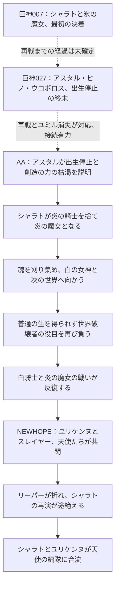

# AAと巨神と誓女：人物対応と時系列

更新：2026-10-11。[作品間の関連一覧](aa-kyoshin-connections.md)を、人物の対応と出来事の前後へ分解した資料。[動画・秒数付きJSON](aa-kyoshin-person-timeline.json)に根拠を記録。

今回、巨神の《炎の騎士》エヴァ004とセラフ005の本名欄が、AAオリフラムと同じ「シャラト・アズリア」であることを映像で確認した。炎の騎士と魔剣の役割も重なり、人物史を接続する最も強い候補となる。エヴァとセラフの別表示名がどの形態・年代に当たるかは未確定で、台帳のIDは統合していない。

NEWHOPEの説明により、対応は「同じ名前」だけでなく「過去の人物」「その物語を読む者」「再演する役割」「現在の身体」に分けて読む必要がある。特にローラ、ユリケンヌ、オフィーリアは、白い剣・白騎士に関わる役割が重なっても同じ人物として一括登録しない。

## 人物対応

|人物・組合せ|現在の判断|根拠|区別・残る確認|
|---|---|---|---|
|シャラト・アズリア：オリフラム／エヴァ／セラフ|巨神007本文・誓女004/005・AA032の本名一致確認|巨神007の1905秒で氷の魔女が炎の騎士をシャラト・アズリアと呼ぶ。誓女004エヴァ・005セラフの本名欄とAA032オリフラムの本名が一致。称号だけの対応から本文の実名による対応へ進展。|作品別・表示名別IDは維持。エヴァの紹介詩は流浪・騎士王・不死の騎士、セラフは魔剣の内在・ノイアの騎士・悠久の時を越える者を描き、段階差を示す。ただし変化の瞬間、セラフとAA炎の魔女の姿の一致、同じ身体の連続性は未確認。|
|アスタル／白の女神|名前・方舟・終末の連続した接点|巨神005の娘、013の封印された女神、027の白滅の聖女と、AA032のアークのアスタルが対応候補。AA032の680秒では白の女神はアスタルの姿をしていると明示。|姿をしているという記述を同一人格の確定に変えない。AA側の天使候補IDは発行しない。|
|ローラ・オーランド／セヴン（ユリケンヌ）|剣を捨てたという旧記録を訂正・三場面を区別|巨神021の1840〜1870秒は聖剣を握り、ヨヨの声、オーロラに光が戻る、別れと剣を振り上げるという順。AA058の215秒はヨヨを殺した回想、735秒は聖堂騎士としての死に続きただのローラとして歩き出す。AA032の390秒は炎の騎士に敗れ聖剣を捨てた過去、610〜630秒は人工心臓の限界と魂の吸収。 巨神021の別れ→AA058冒頭の喪失回想は接続が強まる。AA058の旅立ちとAA032の死は同一瞬間の異説ではなく、AA032が回想する初戦敗北・剣放棄の後に再戦があるという前後候補を優先する。|巨神021の抜粋は斬撃後の両者の遺体を明示しない。AA058をAA032の同一世界・同一回の初戦とする明言は未確認。ユリケンヌは物語の読者・継承者として分ける。|
|オフィーリア／スレイヤーと白騎士|AA内の役割対応・巨神の人物は未同定|現在のスレイヤーと、伝承・再演内の白騎士フィーは名前・役割が繰り返される。NEWHOPEではユリケンヌとスレイヤーが同じ場に立つ。|同じ白騎士的役割でもユリケンヌとオフィーリアは別人物。巨神のローラをオフィーリアへ置換しない。|
|メガエラ／教師と黒猫|複数名・役割の一致、姿の接続は保留|両作品で教師メガエラと黒猫メガエラが登場。巨神016はエラリーという呼び名を明示し、今回の誓女097の本名欄にもエラの文字がある。|今回は本名欄の全字形を確読できず転記しない。教師・猫・誓女097を一つの身体として確定しない。|
|クラウス|名と学園での役割の一致|巨神016の眼鏡の教師とAA眼鏡の神獣のクラウスが、メガエラと同じ学園の文脈で現れる。|具体的な世界の同一性と年代は保留。未登録人物のIDを新設しない。|
|ラッチ／ラッチパム|学園の名前・役割一致候補|巨神016の生徒ラッチ、AA学園のラッチ／ミリア・ノヴァクが候補。|AAの本名と巨神側ラッチの本名は未照合。ソフィをリリエル、ガーネットをアイコへ対応させる根拠もない。|
|ライカ／クドリャフカ|姓の相違を再確認・改名の根拠なし|巨神107の120秒の本名はライカ・レオニク。AA039の315秒の本名はライカ・アンタルクトワ。巨神030は都市・移民・メトセラの実験、レメクと巡察師ファラの救出、ファラの死亡とライカたちの脱出。AA039は遊牧民の捕虜・極寒の人工島・王国の人造天使実験、兵士ファラの助力、ライカのみを載せた脱出艇。 ファラ・実験・脱出・氷原の筋は共通するが、姓だけを変えた同一事件ではない。別作品の対応候補として保持する。|今回の名前欄・選定本文には姓が変わる経緯や旧姓の説明を確認できない。転生・改名・別世界の再演のいずれも確定しない。AA側のファラの死も翼に託された命という描写と遺体確認を区別する。|
|ファラ|名前と救出役の一致|ライカの脱出を助けるファラが両作品に登場。|巨神側はレメクとの同行、AA側は監視兵という視点差がある。ファラオちゃん等へ名前だけで対応させない。|
|レインブリンガー／あめりとレイナード|同名の役割と構造、人物は別記|喪失・病・特殊な能力付与・洪水・制止を受ける展開が対応。|AAあめりと巨神レイナードは別の人物記録。巨神のアメリは亡き相手でありAAあめりの同一性を示さない。|
|ザクロ／ピノ：プロセルピナ|本名の共通部分のみ|プロセルピナとプロセルピナ・オートマタで名が重なる。|宇宙から来たプロセルピナと機械人形ピノの経歴の接続は未確認。|
|ユミル／まりか|神格・役割の継承、同じ身体とはしない|AAまりかがユミルから創世の巨人の役割を引き継ぐ。巨神側にも創造の巨神ユミルが登場する。|まりか＝巨神側ユミルの単純な人物対応ではない。|
|ノア／ノイア|神格の比較候補|ユミル、創世、呪い、器との関係が似る。|異なる表記を保持。同じ神の別名と確定しない。|
|ヨシュア・ヨアヒム／学園の名|名前群の照合候補|AA SKYFALLの大佐と巨神037の学園の人物に対応する名前がある。|巨神本文での複合名・呼び分けと軍歴への接続を追加確認するまで同一性保留。|
|ヘルミナ・ヴォイニッチ／エルメ・ヴァイニッチ|姓・名前群の比較候補|禁術研究とヨシュア、エラン／ロランに関連する近い名前群がある。|姓の表記差・名の違いを残し、同一家系も未確定。|
|黒騎士：スイ／クロエ・マスター|称号一致、人物統合の根拠なし|AA魔剣の神獣では黒騎士の正体がスイと明示。巨神125の紹介名はクロエ・マスター。|巨神001の複数の黒騎士も含め称号を一人の固有名にしない。|
|死人王カイネ／尾頭懐音|音の類似、未照合|AA大口縄に死人王カイネが登場し、懐音とも音が近い。巨神の誓女名にもカイネがある。|名の類似のみでは懐音の別名・転生・巨神035の同一性を付与しない。|

## シャラトを軸にした時系列

以下の実線はAA本文で追える相対順。巨神側との点線は接続候補であり、作品間の年代確定を意味しない。032などの番号は動画番号で、出来事の発生順ではない。

- 032オリフラム60〜150秒：アークのアスタルが、ユミルとウロボロスの喪失、出生停止、無の女神の魂回収失敗を説明。
- 同240〜270秒：人々の物語を記す提案を受け、シャラトが炎の魔女となる。同650秒では魂を刈り尽くす。
- 同680〜800秒：アスタルの姿をした白の女神、生命結晶、次の世界への旅と、再び世界破壊者となる役目が描かれる。「姿をした」と人格の同一性は区別する。
- 031_NEWHOPE570〜675秒：ユリケンヌが人工心臓と七度目の戦いを語り、シャラトは既定の結末を再演しようとする。
- 同705〜810秒：スレイヤーと天使たちの介入、リーパー破壊、再演の終了。
- 同870〜975秒：自由な人生への誘い、アイオーンの共感、シャラトとユリケンヌの編隊への合流。

したがって「シャラトは永遠に世界破壊者として反復し続ける」は、NEWHOPEまで含めた状態として採用しない。032の結末は031で決着する前の段階。世界全体の再演・全神獣・全戦争の終結までを意味するものではない。

## ローラからユリケンヌへ

巨神021のローラ・ヨヨ・アダム・オーロラ →〔物語の接続候補〕→ AA058で読まれるローラの物語 →〔本文で明示〕→ ユリケンヌがオーロラを継ぐ → NEWHOPEの白騎士としての再戦 → スレイヤーとの共闘と自由な生。

巨神021の1840〜1870秒で聖剣を握り、光が戻って剣を振り上げる順を確認。AA058の215秒のヨヨ殺害とアダム喪失の回想へ接続する有力な手掛かり。旧記録の「剣を捨てる」は訂正した。さらにAA032で人工心臓の限界を迎えるローラ、AA058で自由に歩き出すローラ、031のユリケンヌによる再戦は、同一回の戦闘の異なる説明と決めつけず、再演・別世界・継承者の違いを残す。

スレイヤーはNEWHOPEでユリケンヌと同じ場に立つ。よって白騎士という役割を根拠に、オフィーリア＝ユリケンヌとする対応は成立しない。

## 巨神側で追える世代と前後

ベアトリスの時代（ピノの製作とチルの恋） → エイレーンとブラッドの逃走・チルの死 → ピノが二人をアークで送る → アークの破壊 → アスタルと人の姿のウロボロス、ピノが生きる終末。

謳013・017・027・042の人物名と共通事件から組み立てる相対順。各動画は回想を含むため、動画一本を一つの年代へ固定しない。先代氷の魔女と末裔サイレンの間には長い年月があるが、ナルハート・シェラザード・サイレン・誓女003の本名を一本の人物史としてはまだ接続できない。

## 懐音とまりか、AA天使隊の時間層

懐音とまりかの学生時代 → ユミルの創世の役割をまりかが引き受ける／懐音が永遠の呪いを受ける →〔転生前記憶説が有力だが機構未確定〕→ 045で過去を体験し現在のエオンへ戻る → 天使化後の人物関係 → NEWHOPEでアイオーンがシャラトを支える。

045の青い時計8:54は過去への移行、黄色い時計10:56は現在への帰還。過去が存在したこと、林檎で記憶を体験すること、転生の仕組みの確定は分けて扱う。

別に、ユノの物語には帝国暦2020年の過去と2021年の戦場が明記される。これは同じ暦の内部で前後を確定できるが、渋谷の地球の年号や巨神側の年代との換算根拠はない。天使隊成立後にNEWHOPEの編隊があるという大枠と、各個人の天使化の細かな順序は区別する。

## 全体年表に置けない筋

- 学園016・037とAA学園：ヨアヒムの学園長就任とクラウス新任、AAのメガエラ・ラッチ等の世代を確定できない。
- 現代のアイノ・ユミ、レイナード、DJ：同じ現代風でもAAの渋谷と同じ年代・同じ地球とする根拠がない。
- ライカとファラの二つの脱出：共通の事件、再演、別世界の対応のいずれか未確定。
- AAユノの軍歴と懐音・まりかの長期史：2020/2021は帝国暦であり、渋谷の学生時代からの年数換算がない。
- 創世のユミルとまりかの役割継承：同じ名の創世を一回の事件へ統合しない。何回目の世界か未確定。

現時点で作れるのは、複数の世界・世代を保持した相対時系列。全動画を単一の西暦・一本道に並べた年表は根拠不足となる。

## 追加確認を絞る箇所

1. エヴァとセラフの紹介詩の段階差は確認済み。変化の瞬間とAA側の姿の対応を確認する。
2. 巨神007の炎の騎士の実名確認は完了。017の先代氷の魔女との戦いの接続を残す。
3. 巨神027終末とAA032冒頭の再戦・ユミル消失は照合済み。黒猫を連れた魔女の実名と三筋の光の対応を残す。
4. ローラの剣放棄の旧記録は訂正済み。残るのはAA058の初戦とAA032の再戦が同じ世界・回に属するかの明言。
5. ライカの両姓と脱出事件の違いは確認済み。改名・転生の明言が得られるまで別作品の対応候補とする。学園の世代差は別途保留。

## 今回の確認と限界

誓女004・005・058・097・107の映像18枚を確認（既確認時刻との重複を除いた追加は15枚）。既存032オリフラムの画像14枚を、時系列と白の女神の表現に絞って再照合した。人物対応17件、出来事21件、前後または接続候補16件をJSONに記録。全ページの連続精読・音声確認は未実施。人物台帳・ゲーム内設定・会話は変更していない。

## 追加照合：炎の騎士の実名と二度の戦い

- 巨神007 31:45：氷の魔女が「シャラト・アズリア」と呼ぶ。エヴァ・セラフ・オリフラムとの本名一致を本文でも確認。
- 誓女004/005 各0:20：エヴァは流浪・騎士王・不死の騎士、セラフは魔剣を内に宿し、ノイアの騎士として悠久を越える者。異なる段階を示すが、変化の瞬間とAA側の姿の対応は未確定。
- 巨神007 37:45〜39:15：龍の骨と凍った心臓、氷の魔女の犠牲、魔法の喪失。巨神027の決着とは区別する。
- 巨神027 24:15〜26:15：炎の騎士と黒猫を連れた魔女がアスタルを守る再戦。ウロボロス敗北、ユミルの骸の消失、人の姿になったウロボロスまで追える。AA032冒頭との接続が具体的な出来事でも強まった。
- 同29:15：生命の結晶の緑、騎士の赤、魔女の青が空へ上る。AA032の次の世界への旅と対応する候補だが、三者の同一性と厳密な同時性は保留。

今回の追加確認は巨神007の32枚、027の30枚、誓女004/005の24枚。時刻指定の静止画による本文照合で、全編連続再生・音声確認は未実施。この時点で残した三課題は、末尾の追加照合で更新した。007の騎士の実名確認は完了として繰り返さない。

## 黒猫の魔女・ローラ・ライカの追加照合

### 巨神027の黒猫を連れた魔女

**サイレンが有力・実名未確定。** 巨神017の240秒はサイレンと黒猫メガエラ、1650秒は氷の魔女サイレン、1740秒はメガエラと共闘する二人を明示。90秒の先代シェラザードは混沌の龍に挑んで死亡し、サイレンはその末裔。

027で炎の騎士と並びアスタルを守る黒猫連れの魔女は、先代よりもサイレンを優先候補にする。

残る確認：027の1455秒自体には魔女と黒猫の実名がない。同伴猫の一致から確定には上げない。誓女003、先代シェラザード、サイレンのIDは統合しない。

### ローラの結末と前後

**剣を捨てたという旧記録を訂正・三場面を区別。** 巨神021の1840〜1870秒は聖剣を握り、ヨヨの声、オーロラに光が戻る、別れと剣を振り上げるという順。AA058の215秒はヨヨを殺した回想、735秒は聖堂騎士としての死に続きただのローラとして歩き出す。AA032の390秒は炎の騎士に敗れ聖剣を捨てた過去、610〜630秒は人工心臓の限界と魂の吸収。

巨神021の別れ→AA058冒頭の喪失回想は接続が強まる。AA058の旅立ちとAA032の死は同一瞬間の異説ではなく、AA032が回想する初戦敗北・剣放棄の後に再戦があるという前後候補を優先する。

残る確認：巨神021の抜粋は斬撃後の両者の遺体を明示しない。AA058をAA032の同一世界・同一回の初戦とする明言は未確認。ユリケンヌは物語の読者・継承者として分ける。

### ライカの姓と脱出

**姓の相違を再確認・改名の根拠なし。** 巨神107の120秒の本名はライカ・レオニク。AA039の315秒の本名はライカ・アンタルクトワ。巨神030は都市・移民・メトセラの実験、レメクと巡察師ファラの救出、ファラの死亡とライカたちの脱出。AA039は遊牧民の捕虜・極寒の人工島・王国の人造天使実験、兵士ファラの助力、ライカのみを載せた脱出艇。

ファラ・実験・脱出・氷原の筋は共通するが、姓だけを変えた同一事件ではない。別作品の対応候補として保持する。

残る確認：今回の名前欄・選定本文には姓が変わる経緯や旧姓の説明を確認できない。転生・改名・別世界の再演のいずれも確定しない。AA側のファラの死も翼に託された命という描写と遺体確認を区別する。

今回97枚の抽出静止画を確認し、AA032の既存7枚を再照合。全編連続再生・音声確認は未実施。根拠時刻はJSONのreviewFindingsに保存。

## ストーリー・オーパーツからの補足（2026-10-11）

対象はOP、ST01〜08、オーパーツの10本。選定静止画166枚を確認した。全編の連続再生と音声は未確認。ST08は複数章とイベント終盤の会話を含み、収録順を世界全体の時系列には置き換えない。

| 確認事項 | 出典・時刻 | 確認内容と留保 |
|---|---|---|
| 天使・神獣と万物の書 | ST08.mkv 91:30、92:30 | アイオーンは神獣が他者の物語を設計図として世界を再創造し、創世神になろうとすると説明。エニグマは天使と神獣が根で同じもの、万物の書・図書館世界の物語につながると説明。 共有する物語の基盤を示す。個々の天使と誓女の同一人物・転生を自動的に確定しない。 |
| 神獣化からの帰還 | ST08.mkv 92:50、93:00 | フォビドゥンはスレイヤーの白の神獣化、エイプリルのフラワーモードと、自己存在を保って天使に戻ったことを説明。白の神獣崩壊・万物の書封印後もスレイヤーが健在だと述べる。 この会話が振り返る事件の局所順序。全ての神獣消滅や全ストーリーの終了を意味しない。 |
| 白の剣オーロラの由来 | オーパーツ.mkv 08:30 | 説明文は名を奪われた女神が世界創世（アルテ・マグナ）を阻止する装置として造ったと記す。人間の魔術師が神の封印を再度試みた際に阻止し、人の姿となり人として生きたことがある。 人の姿の実名はこの説明にない。ローラ・ヨヨ・ユリケンヌの誰かと即断しない。 |
| 水晶の薔薇と巨人の生命情報 | オーパーツ.mkv 09:00 | 古の時代に栄えた巨人の生命情報を蓄えた結晶。ヒトの心臓に刺すことで肉体を巨人へ造り替えられると説明。 巨人とAAの身体変化を結ぶ明示資料。ただし巨神と誓女の特定人物や世界との同一性は未確定。 |
| 真の龍の肉 | オーパーツ.mkv 08:50 | かつて世界を蹂躙した不死の怪物の断片で、全て食べ尽くすと再び世界に蘇ると説明。 巨神007・027やAA032の龍との対応は候補。説明文だけでは同じ個体と断定できない。 |
| クドリャフカとナイトホーク | ST07.mkv 03:00、03:30、04:00、04:30 | ナイトホークがクドリャフカと歩き、動く影から守ろうとする。影はエキドナの触手で、後に抱擁して安心させる。 艦内での信頼関係を補足する。姓がレオニクからアンタルクトワへ変わる説明は確認できない。 |
| メサイアと別のイオナの物語 | ST08.mkv 29:00、29:40、30:00、30:20、30:40、31:00、31:30 | アイオーンは別のバージョンの物語としてイオナが蛇にそそのかされ人々を裏切る筋を説明。スレイヤーはメサイアに世界のために死なない救世主でいてほしいと伝える。 作中人物が紹介する異なる版の物語と、現在のメサイア自身に起きた事件を区別する。 |
| ブラスフェミィと再演 | ST08.mkv 90:30 | アイオーンは空中戦艦ブラスフェミィを超巨大な神器（レガシーアームズ）と呼び、世界の変化と共に現れる花咲く武器の再演として説明する。 物語の再演は人物以外にも及ぶ。似た外見を根拠とする人物統合は避ける。 |

## エピローグによる終点の補足（2026-10-12）

`エピローグ.mkv` の抽出80枚と重要字幕・説明文の原寸を確認。音声・全編連続再生は未確認。[時刻別の観察記録](../references/aa-epilogue.md)を正本とする。

0:15のユノ少尉の報告で最後の神獣撃破と任務完了、0:19〜0:22で物語が終わった後も人生が続くことを確認。0:28で再演の終了、0:35で書を閉じなかったことによる話者の存続、0:52〜0:56で世界が滅びずユーファリアが過去の物語から自由になったことが語られる。0:58〜1:08は次の書・世界への呼びかけで、1:15から旅立つ者と残る者の見送りへ続く。

これをAAの終幕の局所順序へ追加する。最後の神獣の固有名や、ST08の白の神獣崩壊・書の封印との詳細な前後は今回の台詞だけで固定しない。次の世界への呼びかけを移動完了と扱わない。

2:05〜2:40のエンドカード後の映像にはピンク髪の小さな人物と、大きな構造物・水・植物が映る。人物名・場所・年代の説明がなく、巨神側への接続や転生は未確定。海軍式典の集合写真の説明（3:35以降）は仲間との記憶と別々の進路の可能性を補足するが、特定人物の死亡を示すものではない。

黒猫を連れた魔女の実名、ローラの結末の連続性、ライカの姓の違いは引き続き保留。終戦後の所属・同行・移動を全ヒロインへ一律に付与せず、人物本文の時点を区別する。
